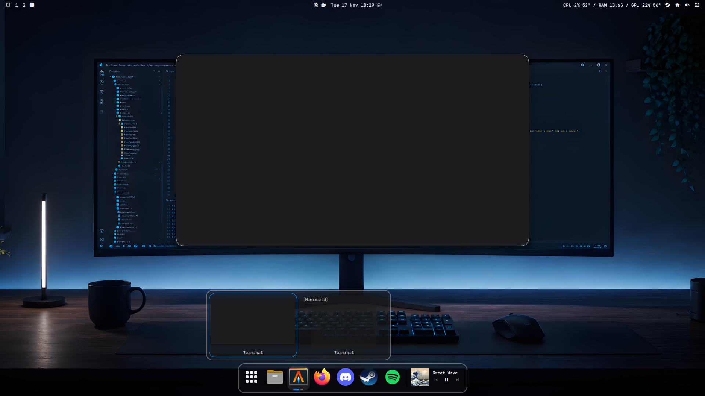
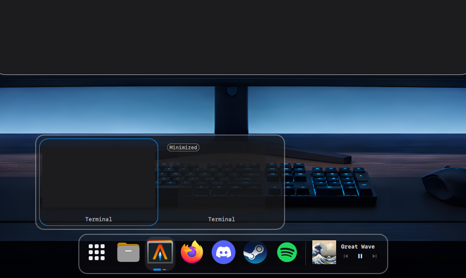
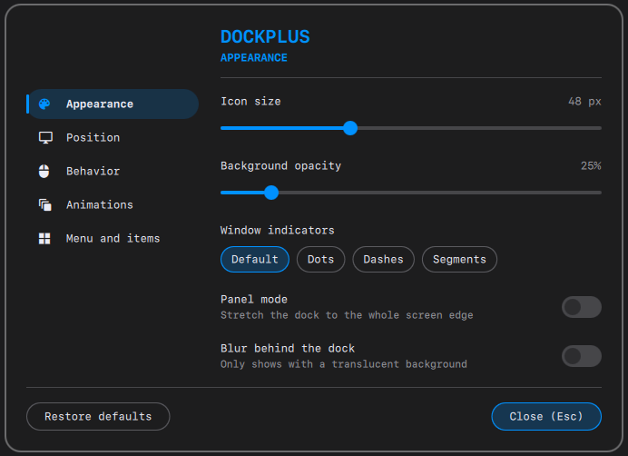
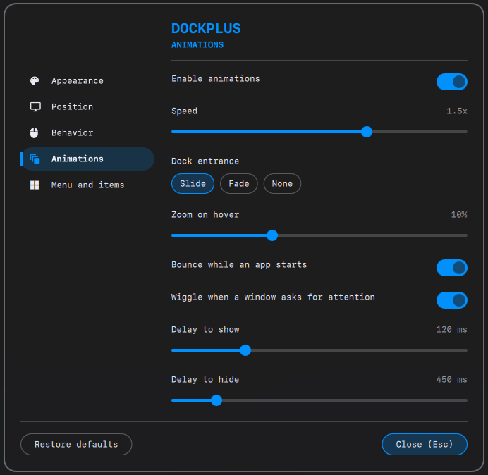
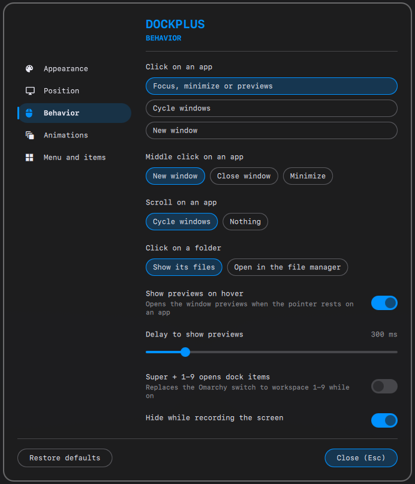
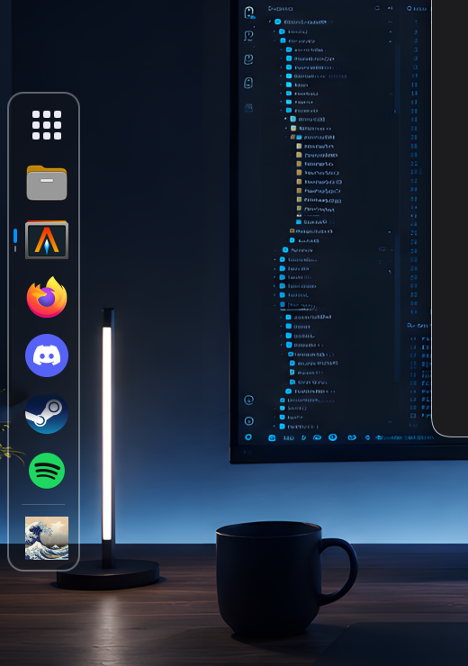

# DockPlus

[](https://omarchy.org/)
[](https://github.com/gabrielsitta4/dockplus/releases)
[](https://quickshell.org/)
[](LICENSE)

A Dash to Dock style dock for the Omarchy shell. Hyprland has no minimize, so DockPlus adds one: minimized windows stay on their app icon and come back with a click.



## Features

- One icon per app: pinned apps, running apps and their minimized windows together.
- Real minimize, including the minimize button of X11 apps such as Steam.
- Live window previews on click or on hover, and a picker for every minimized window.
- Right click menu with the app's own actions (Steam Library, a Firefox private window), its recent files, media controls for music and video, and a way to move a window to another workspace.
- Drag any icon to reorder it. Drop files on an app to open them, on a drive to copy them, or on the trash to delete them.
- Trash, removable drives, pinned folders and an applications button, each one optional. A pinned folder opens as a stack of its newest files with thumbnails, made in a separate process and shared with your file manager.
- What is playing at the end of the dock: cover, track name, play or pause and next. Right click switches player when more than one is open, middle click plays or pauses, scroll skips. On a side dock only the cover shows and a click opens the controls.
- Steam games and agent windows get their own icon and name, including native games that have no window class of their own.
- Unread counts and progress bars on the icons, from the apps that publish them. Other apps get a count of their notifications that clears when you open the app.
- Bottom, left or right edge, autohide, panel mode, optional blur, and it stays out of fullscreen games and screen recordings.
- Scroll to cycle windows, a bounce while an app starts and a wiggle when a window asks for attention.
- Settings window with tabs for appearance, position, behavior, animations and the menu and items, and a button that restores the defaults.

## Screenshots

| Previews | Minimized windows |
| --- | --- |
|  |  |

| Settings | Animations |
| --- | --- |
|  |  |

| Behavior | Left edge |
| --- | --- |
|  |  |

## Requirements

Omarchy 4 (Quattro). Everything else ships with Omarchy: `python3` and `python-gobject` for the X11 minimize helper, the icon badges, the notification counts and the recent files, `udisks2` and `gvfs` for drives and trash, `gtk-launch` and `uwsm` to start apps.

## Install

```bash
omarchy plugin add https://github.com/gabrielsitta4/dockplus --enable
```

Right click any icon and pick **Dock settings** to change anything, or run `omarchy-shell dockplus settings`.

Keep Omarchy's own `omarchy.dock` plugin enabled. It already stays hidden in tiling, and the applications grid behind the DockPlus apps button and `SUPER + ALT + SPACE` comes from it.

## Keybindings

DockPlus adds no keybinding on its own. Add the ones you want to `~/.config/hypr/bindings.lua`.

Omarchy already uses `SUPER + S` for the scratchpad, so unbind it first to put the dock there:

```lua
hl.unbind("SUPER + S")
hl.unbind("SUPER + ALT + S")

o.bind("SUPER + S", "Minimize window", "omarchy-shell dockplus minimize")
o.bind("SUPER + SHIFT + S", "Restore last minimized window", "omarchy-shell dockplus restore")
o.bind("SUPER + ALT + S", "Pick minimized window to restore", "omarchy-shell dockplus pick")
```

Pick another letter if you use the scratchpad. With preinstalled application bindings on, Omarchy already holds `SUPER + SHIFT + S` for Google Maps and `SUPER + SHIFT + M` for Spotify, so run `hyprctl binds` before choosing.

Two settings touch Hyprland while they are on. **Super + 1-9 opens dock items** binds `SUPER + 1..9` to the dock instead of the Omarchy workspace switch, and **Blur behind the dock** adds a layer rule for the dock surface. Both change the running Hyprland configuration only, never your config files, and `hyprctl reload` undoes either one.

Other commands: `omarchy-shell dockplus settings`, `activate <N>`, `pin <appId>`, `unpin <appId>`, `folder <path>`, `unfolder <path>`, `move <appId|@drives|@trash|@apps|@folder:path> <index>` and `position <bottom|left|right>`.

## Configuration

Stored in `~/.config/dockplus/config.json` and edited by the settings window, which also restores the defaults (the dock order stays):

- Appearance: `iconSize`, `backgroundOpacity`, `indicatorStyle`, `panelMode`, `blur`.
- Position: `position`, `monitor`, `autohide`, `isolateMonitors`, `isolateWorkspaces`.
- Behavior: `clickAction` (`smart`, `cycle`, `launch`), `middleClick` (`newWindow`, `close`, `minimize`), `scrollAction` (`cycle`, `none`), `folderClick` (`stack`, `open`), `previewOnHover`, `previewDelay`, `superNumbers`, `hideWhileRecording`.
- Animations: `animations`, `animationSpeed`, `revealStyle` (`slide`, `fade`, `none`), `hoverZoom`, `launchBounce`, `urgentWiggle`, `showDelay`, `hideDelay`.
- Menu and items: `showPinned`, `appBadges`, `notificationBadges`, `showAppsButton`, `showTrash`, `showDrives`, `mediaItem`, `showMedia`, `showRecent`.
- `pinned`: dock order, desktop entry ids plus `@drives`, `@trash`, `@apps` and `@folder:<path>`.

To keep a window out of the dock, give it the Hyprland tag `dockplus-hide`, for example with a window rule.

## Tests

```bash
./tests/run.sh
```

Runs the pure logic and the drive parsing in a throwaway Quickshell config. Prints every failing check and exits non zero if any of them failed.

## Minimize button in Wayland apps (optional)

Hyprland ignores the minimize button of Wayland apps and does not tell them it can minimize, so most of them hide the button. The `hyprland-plugin` folder has a small Hyprland plugin that fixes both and hands the click to DockPlus. It is optional and builds on your machine, so it needs `base-devel`.

Load it at login, it rebuilds itself after a Hyprland update. Add to `~/.config/hypr/autostart.lua`:

```lua
o.launch_on_start(os.getenv("HOME") .. "/.config/omarchy/plugins/io.github.nventatech.dockplus/hyprland-plugin/load.sh")
```

Omarchy shows only the close button, so add minimize to the layout. Run this, then put `gtk-decoration-layout=appmenu:minimize,close` under `[Settings]` in `~/.config/gtk-3.0/settings.ini` and `~/.config/gtk-4.0/settings.ini`:

```bash
gsettings set org.gnome.desktop.wm.preferences button-layout 'appmenu:minimize,close'
```

Apps opened after this show the button. To remove it, delete the autostart line and run `hyprctl plugin unload ~/.cache/dockplus/dockplus-minimize.so`.

## Limitations

Without the optional Hyprland plugin below, the minimize button drawn by a native Wayland app does nothing: Hyprland drops the request. XWayland apps such as Steam work either way.

With the dock on an edge shared with another monitor, the pointer crosses to the other screen instead of stopping. That makes the 2px reveal strip hard to hit while autohide is on.

## Remove

1. Turn off **Super + 1-9 opens dock items** if you turned it on (or run `hyprctl reload` afterwards).
2. Run `omarchy plugin remove io.github.nventatech.dockplus`.
3. Delete `~/.config/dockplus` and any DockPlus lines you added to `bindings.lua`.

## Donate

If DockPlus is useful to you, you can support it through PayPal:

[](https://www.paypal.com/donate/?business=SR28XBBCYSPHE&no_recurring=0&item_name=Help+me+buy+a+coffee.&currency_code=USD)


## License

[GPL-3.0](LICENSE)
